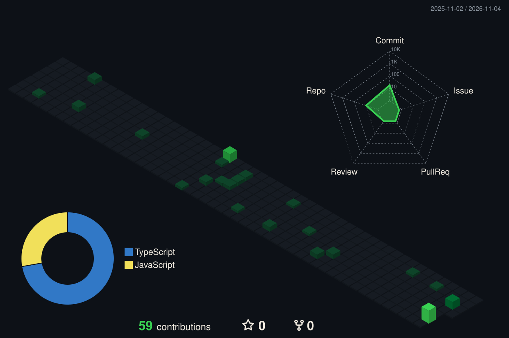
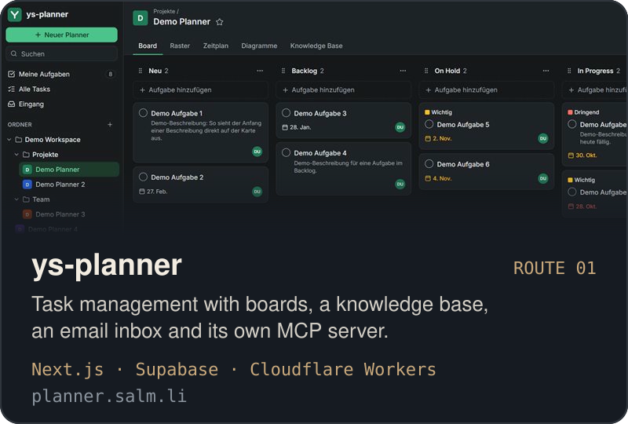
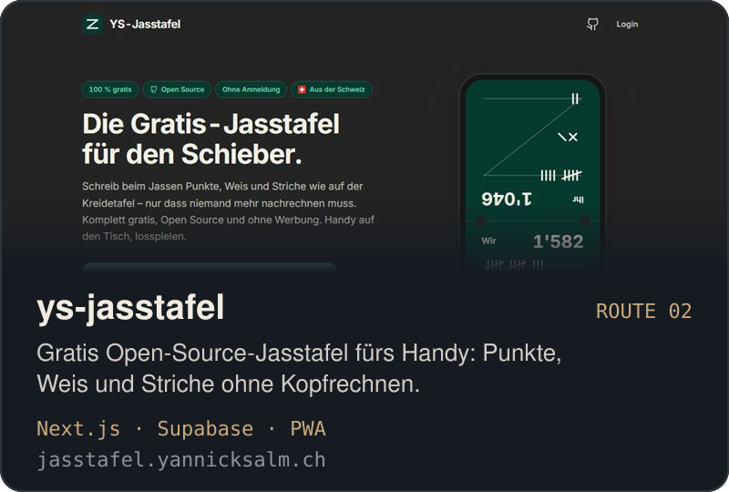
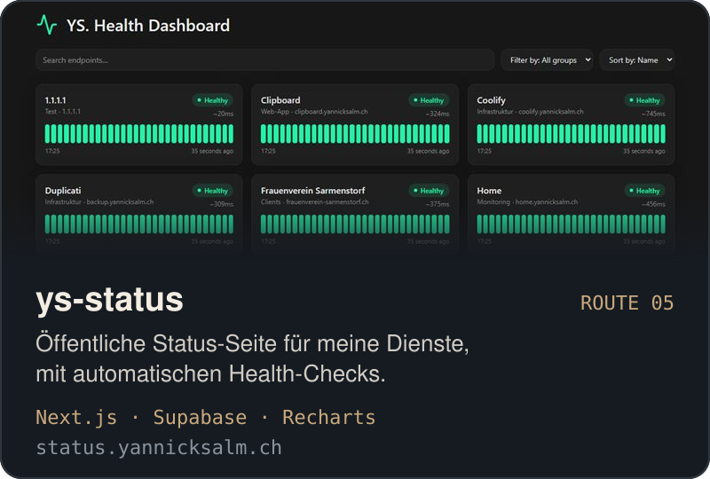

Ich baue Web-Apps von der ersten Idee bis zum Betrieb und betreibe die Infrastruktur dahinter selbst: vom Cloudflare Worker bis zum eigenen Proxmox-Cluster im Homelab.

## Höhenprofil

Jede Contribution ist ein Stück Gebirge.

## Routen

Karten führen zur Live-Seite. Code: [ys-planner](https://github.com/Sky-Walker-xlsr/ys-planner) · [ys-jasstafel](https://github.com/Sky-Walker-xlsr/ys-jasstafel) · [ys-workout](https://github.com/Sky-Walker-xlsr/ys-workout) · [ys-ptone](https://github.com/Sky-Walker-xlsr/ys-ptone) · [ys-status](https://github.com/Sky-Walker-xlsr/ys-status) · [ys-homepage](https://github.com/Sky-Walker-xlsr/ys-homepage)

## Ausrüstung

## Basislager

[yannicksalm.ch](https://yannicksalm.ch) · [info@yannicksalm.ch](mailto:info@yannicksalm.ch) · [Instagram](https://instagram.com/yannicksalm)
